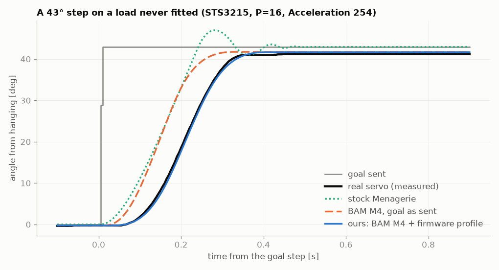

# The STS3215 tracks its own acceleration profile, not your goal

> **Update, 1 Nov 2026 (late).** An earlier note here said the rule fails with no load. That did not replicate: a second servo with only the horn (no rod) gave 7.2 rad/s² at cap 50 (rule 7.7). The rule held in 6 of 7 cap-50 tests; one unit's horn-only run is an unexplained exception, still open. Maximum_Acceleration = 0 switches the profile off (fixed in the code).

Vato Labs, measured 30 Oct to 1 Nov 2026.

**Result.** At LeRobot's own settings (P=16, Acceleration and Maximum_Acceleration 254), on a single servo on a
bench, mean position error against the real servo:

- stock MuJoCo Menagerie SO-101 actuator: 68.3 mrad (3.9°);
- BAM's STS3215 model, goal as sent: 18.1 mrad (1.0°);
- the same model, goal passed through the profile below: **7.1 mrad (0.4°)**.

The model was fitted only on public logs and never saw any of our bench runs. The profile alone cuts its error
2.1-2.8x across six loads on one servo, and 2.5-3.5x on six servos at a light load.



*Goal as logged; the single point at 29° is one intermediate logged sample of the step. "BAM M4" is BAM's STS3215
model structure M4.*

**What.** The STS3215 servo in the SO-101 arm does not drive its position loop straight to the goal you send. It
moves an internal target toward the goal at constant acceleration, braking in time to stop on it, and the loop
follows that target. The acceleration comes from two registers:

**a = 100 steps/s² × min(Acceleration, Maximum_Acceleration)**, Acceleration 0 acting as 50 (measured at caps 50
and 254). One unit is 0.153 rad/s². LeRobot writes 254 to both, which gives 38.96 rad/s². Maximum_Acceleration
(register 85, factory 50) = 0 switches the profile off.

The unit of register 41 was already documented, and register 85 was already described as an acceleration limit
(see Credits). T-K-233 first showed that 85 limits the profile in practice, and how to switch it off, in
[Rhoban/bam PR #20](https://github.com/Rhoban/bam/pull/20) (29 Sep). That PR also published 12 V logs recorded
with the profile switched off, and BAM has clamped the velocity of an internal target since March 2025. What we
add is the min() rule over register 85, Acceleration 0 acting as 50, the profile's shape measured on a bench, and
what it is worth to a model across loads and servos.

**Evidence.** BAM's STS3215 model structure (Rhoban), fitted by us to T-K-233's public 12 V STS3215 logs (PR #20,
recorded with the profile off) before we had any bench data, and never fitted to the bench. Scored by mean
absolute position error on a single-servo rod bench, over BAM's four powered trajectories. Loads are gravity
torques.

| Data | Goal as sent | Through the profile |
|---|---|---|
| Load 0.58 N·m, kept back for the refit test below (12 runs) | 18.1 mrad | **7.1 mrad** (stock Menagerie: 68.3) |
| 5 other loads 0-0.86 N·m (12 runs each) | 18.1-21.3 | **6.5-10.1** |
| 6 servos, 0.19 N·m (12 runs each) | 18.4-18.9 | **5.2-7.4** |
| Factory setting, before LeRobot writes 254: Maximum_Acceleration 50, P=32, 0.19 N·m (5 runs, 5 trajectories) | 93.3 | **8.0** |

All rows but the last are at LeRobot's settings. It is not just latency: the best constant delay on the goal as
sent (20 ms, searched over 0-150 ms) reaches only 15.5-17.4 mrad on three of the loads (0, 0.58 and 0.86 N·m).
Refitting the model on the five other loads gives 5.2 mrad (0.30°) on the 0.58 N·m load. Its pass mark (at most
10.7 mrad, and below the never-fitted 7.1) was fixed before that load was run.

**Measured vs assumed.** The following are measured, all at the factory cap or above:

- Steps at cap 50 accelerate and brake at 6.6-7.2 rad/s² (two servos) against 7.7 predicted. The velocity profile is a symmetric triangle with no cruise phase.
- Acceleration 0 behaves as 50 at both caps.
- The min() cap holds.

At 254 the motor saturates before the profile peaks, so only the start of each move shows it. Re-planning toward a moving goal is assumed, and it is our worst case. We never set a speed limit, so no cruise phase was tested.

PR #20's two other findings, confirmed here: 85 = 0 switches the profile off (47.9 rad/s², then limited by the
motor and gain), and a write to 85 does nothing until 41 is written (85 = 0 alone still gave 7.0). Written with
the EEPROM lock off, 85 survives a power cycle. PR #20 gives 10-28 rad/s² at the factory setting, against our
6.6-7.2, measured on two loads (0.19 and 0.58 N·m) and two gains. We have not explained the difference; its method
is not stated, and ours is the slope of the measured speed during 43° steps.

**Fix.** Pass your goals through [`sts3215_profile.py`](sts3215_profile.py) (about 20 lines of code) and simulate
the servo tracking the result.

**How the numbers were made.**
- Every run since the evening of 30 Oct logs the registers the servo reported (a full snapshot since 1 Nov). The
  first batch of 30 Oct, before that, uses a register read of the same servo that day. Our scoring refuses a later
  log without them.
- The model's parameters were fixed on public logs (29-30 Oct) before any bench run. Nothing above refits them
  except the one refit line.
- The six-servo row is a re-score of runs logged on 1 Nov, made after this note was first published, with no pass
  mark set in advance.
- `python -m pytest test_profile.py` checks the register rule (Acceleration 0, 1, 254, the min() cap,
  Maximum_Acceleration 0, out-of-range values) and that the profile lands on the goal without overshoot.
- The logs and scoring scripts are not in this repo yet; they are available on request.

**Limits.** Firmware 3.10, one gain (P=16), on a bench rather than the arm. The register tests and the load sweep
are on one servo, in one day, with one cap-50 check on a second servo. The six-servo check is one light load, one
day, with each servo friction-fitted in the same jig. The 0.58 N·m load lies inside the refit's range, and the one
trajectory that switches torque off (free fall, not modelled: 74 mrad) was excluded before that load was run. The full
per-arm calibration tool is in development at Vato Labs.

**Credits** (earliest first).
- [BAM](https://github.com/Rhoban/bam) (arXiv 2410.08650, Oct 2024) supplied the servo model; it has clamped the velocity of the internal target since March 2025.
- K-Scale's servo driver ([zeroth-bot](https://github.com/kscalelabs/zeroth-bot), Feb 2025, then [kos-zbot](https://github.com/kscalelabs/kos-zbot)) converts register 41 at 100 steps/s² per unit.
- An [unofficial STS memory table](https://aifitlab-wiki.super.site/feetech-servo-motor-docs/feetech-sts-servo-memory-table-analysis) gives register 41's unit (8.7°/s²) and describes 85 as a factory acceleration limit. It says Acceleration 0 means maximum acceleration; we measured it acting as 50.
- [sts3215-firmware](https://github.com/0o8o0-blip/sts3215-firmware) (Apr 2026) implements a trapezoid profile and attributes the response delay to it.
- T-K-233 ([Rhoban/bam #20](https://github.com/Rhoban/bam/pull/20), 29 Sep 2026) first showed that register 85 limits the profile and recorded the 12 V logs our model was fitted on.
- [MetalSim](https://github.com/pulipakaa24/MetalSim) (1 Nov 2026) used the same 100 steps/s² unit at 254 and marked the profile's shape as inferred.
- [LeRobot](https://github.com/huggingface/lerobot) sets the arm's registers.

## Use

```python
from sts3215_profile import profile_accel, internal_target
a = profile_accel(254, 254)                   # 38.96 rad/s^2, LeRobot's setting (None if Maximum_Acceleration is 0)
target = internal_target(goals, a, dt=0.002)  # feed this to your simulated servo instead of the goals
```

## Cite

See [`CITATION.cff`](CITATION.cff). MIT licence.
